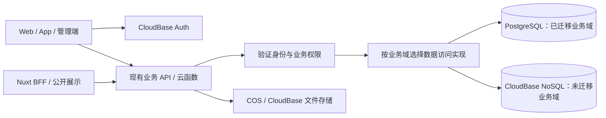

# PostgreSQL 选型、腾讯云预算与 CloudBase 迁移规划

状态：**已决定采用 PostgreSQL；配置为预算建议；迁移尚未启动。**

评估日期：2026-10-23。本文记录项目决策与后续执行门槛，不是部署指令。当前继续使用 CloudBase NoSQL；本轮仅查看代码、云端结构与用量元数据、公开价格，没有读取生产文档正文、导出数据、购买实例或修改云端配置。

## 1. 选型与边界

- 目标产品为**腾讯云云数据库 PostgreSQL（TencentDB for PostgreSQL）**，优先采用社区 PostgreSQL 的功能、SQL 和迁移工具，降低后续更换托管商的成本。
- 本次不是启用 CloudBase PostgreSQL 模式，也不能使用该模式专属的 `app.rdb()` 或身份注入机制连接普通 TencentDB PostgreSQL。现有 NoSQL 环境保留，按业务域迁移。
- **CloudBase Auth 继续作为身份源，用户 UID 保持不变。** 云函数、现有 HTTP API、SSO 协议和 COS 文件存储继续使用，数据库迁移不要求同时更换这些服务。
- 账户服务的唯一实现归 `YunLeFun/api`；本仓支付函数、管理后台和其他应用必须一起参与数据访问改造。详见[账户服务所有权](./account-api-ownership.md)和[服务端职责](./server-responsibilities.md)。
- 当前盘点没有显示容量紧张，暂不采购。先完成设计和演练，确认网络、账本一致性及恢复能力后再安排窗口。

选择 PostgreSQL 的目的是获得关系约束、事务、查询和长期可迁移性。它不能直接执行现有 CloudBase 文档查询：主要工作是重写数据访问、保持业务语义和协调写入方，不能靠更换连接地址完成。

## 2. 当前规模与证据范围

生产环境位于上海 `ap-shanghai`，业务数据库运行模式为 NoSQL。以下为 2026-10-23 的只读盘点，不代表同一事务快照。

| 指标 | 观测值 | 解读 |
| --- | ---: | --- |
| 集合数 | 244，其中 163 个非空 | 包括业务、审计、缓存、测试及平台相关集合，不能全部机械迁移 |
| 文档数 | 10,686 | 集合元数据合计，不是活跃用户数 |
| 数据大小 | 5,583,845 字节，约 5.33 MiB | 不是 PostgreSQL 实际落盘大小 |
| 索引大小 | 22,102,016 字节，约 21.08 MiB | 目标索引需要按查询和约束重新设计 |
| 用量查询返回的读 / 写请求 | 676,990 / 59,691 | 查询 2026-09-23 至 2026-10-22，仅返回 28 条日记录 |
| 2026-10-22 监控读 / 写计数 | 23,457 / 1,610 | 288 个五分钟采样桶，统计方式为 sum |
| 上述单日最大五分钟桶读 / 写计数 | 397 / 111 | 各自最大值；不能当成瞬时峰值或 PostgreSQL SQL QPS |

用量计费口径与监控口径不同，不直接相加或相互换算。日容量计量值不能跨日相加当作当前容量；资源点数不是人民币账单。当前样本说明总体规模小，**不能替代目标 SQL、索引、锁等待和连接数的压测**。

部分业务集合的元数据计数，供确定依赖范围：

| 数据域 | 集合及文档数 |
| --- | --- |
| 账户资料 | `user_profiles` 224；`profiles` 2，需确认两者职责 |
| 钱包 | `user_wallet` 237；`coin_transactions` 539；`coin_reservations` 20 |
| AI 点数 | `ai_point_accounts` 23；`ai_point_transactions` 87；`ai_point_reservations` 22 |
| 订单与会员 | `orders` 21；`user_memberships` 6；`membership_entitlement_transactions` 1 |
| 文件元数据 | `user_storage_files` 24，另有配额及 `drive_*` 相关集合 |
| 公开内容发布 | `public_content_state` 2；`public_content_releases` 4 |

本次检查了官网、API 与 Admin 的部分数据访问代码，尚未完成全生态写入方清单。集合存在不代表功能已上线，空集合也不代表可删除；例如业务集合 `users` 的计数不能代表 CloudBase Auth 用户数。环境摘要另含 MySQL 能力标记，API 仓库也有旧 `prisma/schema.prisma` 使用 MySQL provider，其实际部署与用途尚未核实，不能当作本次账户数据库的目标模型。

## 3. 腾讯云配置与费用

### 3.1 建议配置

| 项目 | 建议 | 依据 / 后续确认 |
| --- | --- | --- |
| 地域 | 上海 `ap-shanghai` | 与现有生产环境同地域；仍需配置 VPC 路由，不能假定自动互通 |
| 引擎 | PostgreSQL 18，采购时使用腾讯云支持的稳定小版本 | 本次规格 API 已返回 PG 18 可售规格；启用前验证驱动、扩展和恢复流程 |
| 实例 | 高可用主实例，一主一备，优先跨可用区 | 主备覆盖故障切换，不能代替备份和恢复演练 |
| 生产预算基线 | **2 核 / 4 GiB / 20 GB 本地 SSD** | 为多业务共用、连接和维护任务留余量；不表示当前负载需要 2 核 |
| 节省成本备选 | 1 核 / 2 GiB / 20 GB 本地 SSD | 适合短期验证；回放、并发及恢复验收通过后，也可作为生产起点 |
| 网络 | 同地域 VPC 私网接入，校验 TLS 与服务端身份 | 验证云函数网络、公网出站和访问控制后再定最终配置 |
| 初始附加项 | 不预购只读实例、数据库代理、Redis 或独立向量库 | 出现实际读负载、连接压力、缓存或向量需求后再评估 |

本次在上海二区、`PHYSICAL_LOCAL_SSD`、PG 18 条件下，规格 API 返回 `pg.it.small2`（1 核 2 GiB）和 `pg.it.medium4`（2 核 4 GiB）可售，存储下限 10 GB。20 GB 是规划容量；实例会有系统表、WAL、临时文件及索引等开销，不能仅按原始数据配置。购买时重新核对可用区库存、主备部署和价格。

### 3.2 数据库公开价格

2026-10-23 查看[腾讯云 PostgreSQL 产品定价页](https://buy.cloud.tencent.com/price/PostgreSQL/overview?region=ap-shanghai)，选项为「上海 / 上海二区 / PostgreSQL / 主实例」，磁盘为「本地 SSD / 主实例」。金额单位为人民币，未计账号合同折扣、代金券或新购活动。

| 方案 | 计算费用 / 月 | 存储费用 / 月 | 数据库合计 / 月 | 12 个月基线 |
| --- | ---: | ---: | ---: | ---: |
| 1 核 2 GiB，20 GB | 204.00 | 14.40 | **218.40** | 2,620.80 |
| **2 核 4 GiB，20 GB** | **408.00** | **14.40** | **422.40** | **5,068.80** |
| 4 核 8 GiB，50 GB | 816.00 | 36.00 | **852.00** | 10,224.00 |

存储单价为 0.72 元 / GB / 月。主实例是高可用产品，表中不再把计算费用乘以两个节点。12 个月基线按月价乘 12，最终年付折扣以实际报价为准。4 核 8 GiB 目前没有采购依据。

短期云端演练可采用按量计费，**现在不创建**。公开计算阶梯价为：

| 规格 | 前 96 小时 | 第 97 至 360 小时 | 超过 360 小时 |
| --- | ---: | ---: | ---: |
| 1 核 2 GiB | 0.56 元 / 小时 | 0.42 元 / 小时 | 0.28 元 / 小时 |
| 2 核 4 GiB | 1.12 元 / 小时 | 0.84 元 / 小时 | 0.56 元 / 小时 |

磁盘另计 0.001 元 / GB / 小时。新建实例连续运行的示例：

- 1 核 2 GiB、20 GB，7 天：`96 × 0.56 + 72 × 0.42 + 168 × 0.02 = 87.36 元`。
- 2 核 4 GiB、20 GB，30 天：`96 × 1.12 + 264 × 0.84 + 360 × 0.56 + 720 × 0.02 = 545.28 元`。

这些仅为数据库费用。完成验证后再比较长期包月 / 年付。账号询价 API 本轮缺少 `postgres:InquiryPriceCreateDBInstances` 权限，因此这里是可复核的官网估算，**不是该账号已确认的采购报价**。

### 3.3 其他成本与预算边界

1. **现有 CloudBase 费用继续存在。** Auth、云函数、部分 NoSQL 和文件服务仍在使用；数据库迁移不会立即抵扣当前套餐，迁移期还会并行运行。
2. **VPC 公网出口可能比存储更贵。** 云函数接入 VPC 后，要验证微信支付、Apple、GitHub 等出站请求。若需要新建上海标准型公网 NAT，官网新购优惠实例费为 0.195 元 / 小时，30 天基础费用 **140.40 元**，另有 CU、EIP 和公网流量费用；未优惠实例价 0.23 元 / 小时对应 165.60 元。已有出口能否复用尚未盘点，不能把新增 NAT 当作必然，也不能漏算。
3. **422.40 元不是系统总价。** 在需要新建上述优惠 NAT 的假设下，PG 加 NAT 实例费至少为 **562.80 元 / 30 天预算周期**，还需加 CU、EIP、流量、现有 CloudBase 和其他实际用量。这里用一个数据库包月与 NAT 720 小时作比较，真实自然月天数会影响后付费。
4. 本地 SSD 实例的免费备份空间为购买容量的 100%，超出计费。20 GB 数据盘不代表无限备份；保留周期、WAL / 备份占用和额外费用需在演练后测量。
5. 数据库代理、专用运行服务、跨地域灾备和额外日志服务可能另收费，当前没有纳入采购。开发阶段先在本地运行 PostgreSQL，避免长期闲置测试实例。

完整增量预算按「PG + 新增网络 / 运行资源 + 超额备份 + 迁移临时资源 − 确认可减少的原服务费用」计算；没有确认的节省项先计为零。公网出口方案与账号报价是采购前的必填项。

## 4. 接入方式与跨仓库职责

图中的选择是**每个业务域只有一个权威读写数据库**，不是请求失败时自动访问另一份数据。UID 必须从受信任服务端验证后的身份提取，不能直接信任浏览器传来的 `userId`。数据库凭据只放业务服务端，浏览器和 EdgeOne 展示层不直接连接 PostgreSQL。

| 位置 | 当前职责与迁移工作 |
| --- | --- |
| `YunLeFun/api/cloudfunctions/account-api` | 账户、钱包、会员、AI 点数兑换等唯一账户入口；设计数据访问接口、事务和幂等契约 |
| 本仓 `cloudfunctions/wxpay-order/lib` 及支付 / 通知函数 | 共享支付库源代码与订单、权益处理；先改源，再按现有机制同步 API 等部署快照，不能手改副本 |
| `YunLeFun/admin` | 钱包 / 订单 / 会员查询和统计；调整余额已委托账户服务；通用数据库 CRUD 路径也必须纳入写入封锁 |
| www / apps / play / AI Runtime / App 等调用方 | 保持外部 API 契约，盘点直接 SDK 查询、实时订阅、后台任务、支付通知和旧版本客户端；不能仅检查官网 |
| 平台管理的集合与认证服务 | 单独确认所有权及产品支持，不直接复制到 PostgreSQL 后删除原资源 |

需要逐个验证运行时的 VPC、子网、路由、DNS、安全组、TLS 和公网出站行为；CloudRun 与云函数的出站配置不同，不套用同一假设。连接池先以每个常驻执行容器少量连接（例如 1–3）做实验，按最大容器数限制总连接预算，预留管理与后台任务连接，设置获取连接和 SQL 超时。事务必须固定在同一连接，不在事务中调用第三方网络接口。

运行账号、只读运维账号与 schema migration 账号分离，运行账号不持有建库或超级用户权限。应用层继续执行用户 / `appId` 权限检查。若增加 RLS，另行设计事务级身份上下文与连接池清理，普通 PostgreSQL 不会自动继承 CloudBase 安全规则。

## 5. 数据模型与必须保持的语义

| 项目 | 迁移约束 |
| --- | --- |
| 用户和文档 ID | CloudBase UID、历史 `_id`、订单号、幂等引用保持稳定；优先用 `text` 接纳旧值，不强制转 UUID 或重新生成整数用户 ID |
| 关系 | 先核实实体、孤儿记录和历史兼容逻辑，再加外键；不能把 `user_profiles` 当作完整 Auth 用户清单 |
| 金额与点数 | 金额保留最小货币单位整数，云币 / 点数保留现有整数单位；按范围选 integer / bigint，明确 Node.js 大整数与 JSON 序列化契约，禁止浮点换算 |
| 时间 | 保留毫秒精度和原始时点，可使用 `timestamptz`；自然日、会员月末锚点与 Asia/Shanghai 业务时区单独验证 |
| 灵活字段 | 查询、唯一性及关联字段使用列；灵活元数据用 JSONB，不将所有文档原样塞入一列后宣布完成 |
| 缺失值与查询 | 区分不存在、`null`、空字符串及默认值；数组、嵌套字段、正则和大小写匹配逐项转换 |
| 唯一约束 | 已发现订单 `outTradeNo` 唯一索引、流水 `(userId, type, refId)` 唯一索引；SQL NULL 唯一性与源字段缺失行为需显式测试，不能擅自改变业务键范围 |
| 过期与删除 | TTL 清理、查询时过期判断、账号删除等待期及 tombstone 一起处理；不能依赖清理任务实现授权过期，也不能导入已失效会话使其复活 |
| 文件 | 保留 `cloud://` / COS 对象引用及访问边界，只迁元数据与权限关系，不复制文件到数据库 |
| 历史冲突 | 多份钱包、旧会员 ID、重复引用等一旦发现，隔离并记录处理规则；不静默覆盖、丢弃或重新计算权益 |

**事务边界按当前实现确认。** 钱包余额与流水已使用 CloudBase `runTransaction`；API 云币兑换 AI 点数会在同一事务中扣币、加点数并写两侧流水，必须整体保持。旧文档或注释中的「CloudBase NoSQL 无跨集合事务」不能作为迁移依据。

订单标记已支付与权益发放当前还包含分步处理、幂等及失败补发逻辑，不能误认为已经是一个事务。目标可以重构为数据库内原子提交，但需要保留通知重试、退款及已支付未发放的恢复语义，外部副作用通过可重试 outbox 处理。不能通过重放真实充值 API 导入旧账。

## 6. 分阶段路线

阶段不绑定日期。每阶段验收后再决定是否启动下一阶段，允许长期保留未迁移的数据域。

| 阶段 | 范围 | 进入下一阶段前的产物 |
| --- | --- | --- |
| P0：完整盘点 | 为 244 个集合记录所属仓库 / 服务、读写入口、索引、权限、TTL、事务依赖和保留要求；检查部署版本与直连客户端 | 集合归属表、调用图、事务边界、保留 / 归档 / 迁移清单；核实旧 MySQL 用途 |
| P1：本地设计与演练 | PostgreSQL schema、数据访问实现、类型转换与导入校验；先用合成或脱敏数据；确定连接及恢复策略 | 可重复运行的迁移工具、业务契约测试、网络与费用复核；不切生产 |
| P2：低风险试点 | 优先评估 `public_content_state` 与 `public_content_releases` 一起迁移；COS 内容产物继续使用 | 保持 revision 并发控制、发布指针和回滚语义，验证后台发布与官网读取；依赖过广时重新选试点 |
| P3：其他独立业务域 | 应用目录等先行；资料 / 社交 / 通知、文件元数据 / 配额等按依赖分组 | 每域读写与后台作业完整迁移；账户删除等跨域流程有明确协调机制 |
| P4：账户与资金整体 | 订单、钱包 / 预占 / 流水、AI 点数 / 预占 / 流水、会员权益，以及关联奖励预算 / 发放 / 修正、Play 结算等一致性范围 | 调用方和共享代码版本齐备；支付、兑换、退款、奖励与对账通过；恢复可演练 |
| P5：收尾与可选迁移 | 会话、一次性凭证、限流、审计、缓存等逐项决定迁移、等待过期或保留 | 无旧写入且完成观察及保留周期后，分别退役旧业务集合；Auth 与文件服务不随之删除 |

这是候选顺序，不能为了阶段编号拆开一个事务。P0 如发现资料、配额或奖励与账本存在不可拆分更新，应调整阶段合并迁移。仍有跨库流程时必须定义状态机、补偿及删除传播；实现前不能视作已解决。

## 7. 每域切换与恢复

当前数据小，默认采用**演练后安排短维护窗口，封锁写入，再做最终全量导出与切换**。窗口由演练测量，不承诺零停机或固定几分钟。轮询 `updatedAt` 无法完整覆盖删除和并发更新，不作为可靠增量同步方案。

1. **准备并演练。** 固定代码、schema、字段映射、源数据版本标记和恢复办法；部署尚未启用的 PostgreSQL 实现，检查外部 API、后台和任务兼容；完成备份恢复及切换演练。
2. **封锁全部写入。** 覆盖新订单、支付回调、账户 API、管理后台通用 CRUD、定时任务、脚本、旧函数版本和直连 SDK；记录停用 / 恢复清单，等待在途请求结束。只在官网打开维护开关不足以冻结数据，必须验证源端写入已停止。
3. **处理外部通知。** 冻结期间支付 / 商店通知须进入经过验签、具备幂等键的持久化收件箱，持久化成功后才能确认接收；否则按对应渠道已核实的协议返回可重试结果。不得返回成功后丢弃通知。尚未实现这项能力时，不进入资金域切换窗口。
4. **最终导出。** 在域内冻结后导出全部相关集合，保留类型信息（如 EJSON 或带类型元数据的 NDJSON）、历史 ID、删除标记及版本；生成计数、内容校验和、导出时间和映射版本清单。文件只存受限私有位置，不提交仓库或公开桶，凭据不随数据打包。
5. **导入并校验。** 在暂存区按稳定键幂等导入，转换失败、冲突和异常关联进入失败清单。纯数据导入不得触发付款、通知或重复发放权益。完成校验后再启用业务表最终约束与访问入口。
6. **同时切换该域读写。** 用服务端版本 / 域配置确保唯一权威来源，启用 PostgreSQL 前确认旧写入已封锁。先执行不产生外部副作用的检查，再恢复通知消费、任务和用户写入。PG 故障不得自动回退读取过时 NoSQL 余额或权限。
7. **观察与对账。** 检查错误、锁等待、连接、资金及权益差异和通知积压；旧域保持受控只读。观察期至少覆盖约定的结算 / 对账周期，具体长度在切换前确定。
8. **逐项退役。** 确认无旧版本访问，且归档、恢复和保留要求满足后，再安排旧集合、索引、代码分支和权限退役；不删除整个 CloudBase 环境。中间产物放任务独占目录并在完成后回收，可恢复基线按已记录用途与保留条件管理。

### 回退边界

- **PG 尚未接受新业务写入：** 校验原数据仍冻结且一致后，可恢复旧版本及原域读写。
- **PG 已接受新写入：** 不能只把开关拨回 NoSQL。必须再次冻结，把新增、更新、删除和事务组按已演练的逆向映射回放并对账，或在 PG 侧修复后继续服务；单纯恢复切换前备份会丢失新账。
- 资金域必须在上线前具备完整变更记录 / outbox 与验证过的恢复方案，覆盖删除和关联事务，不能依赖普通应用日志。不可逆 schema 变化事先标明；无法安全逆向时采用修复向前方案并明确故障处理窗口。
- 备份不自动解决未消费回调、重复通知和外部系统状态，恢复演练必须包含这些内容。

若未来无法接受维护窗口，再单独评估 CDC 或事务 outbox：源端写入与事件原子提交、快照水位、删除、顺序、去重、重试、落后量及切换封锁都必须设计。本次未验证 CloudBase NoSQL 到普通 PostgreSQL 存在开箱即用的全量加增量通路，不能先假定 DTS、MongoDB oplog 或双写天然可用。

## 8. 验收与启动门槛

当前完成了选型、只读规模评估、公开预算与路线记录，以下实施项均未完成：

- [ ] 全量集合归属与线上读写入口清单完成，包含其他应用和管理端，未迁集合都有保留理由。
- [ ] 上海 VPC 与云函数出站验证通过；确认 NAT 复用、完整预算、可售版本和账号报价。
- [ ] 确定可接受的数据丢失范围（RPO）、恢复时间（RTO）和维护窗口，写入各阶段执行单，完成备份恢复演练。
- [ ] 导入前后逐集合核对计数、类型；拆表、合表、归档及异常处理有逐条映射，重要字段全量核验，不能只对总行数。
- [ ] 每用户余额、预占、可用余额、会员有效期、AI 点数、订单权益及渠道对账一致；先确认历史期初余额和修正，不能简单用全部流水求和代替账务核对。
- [ ] 支付重复 / 乱序通知、已支付未发放、退款重试、并发消费、预占释放、兑换重复调用、奖励超预算和游戏结算幂等测试通过。
- [ ] 跨用户 / 跨应用访问被拒绝，注销和禁用不会复活账号，一次性凭证不能重用，过期会话保持失效，文件所有权及下载权限不变。
- [ ] 业务负载回放通过，记录 P95、连接峰值、锁等待、慢查询和内存，验证约定峰值及增长余量，确定 1 核或 2 核最终规格。
- [ ] 旧写入封锁、通知持久化、域内唯一数据源及切换后恢复完成演练；各仓库发布顺序与共享代码一致性检查通过。
- [ ] 明确生产执行人、窗口、观察指标、失败处理和数据保留 / 退役条件，再启动相应阶段实际迁移。

实施时每阶段补充执行记录，至少包含日期、仓库提交、schema / 映射版本、源快照清单、校验结果、窗口用时和恢复演练结果。本文不保存用户数据、账号密钥或导出文件。

## 9. 参考与复核入口

代码与项目约定：

- [账户服务所有权及共享代码流程](./account-api-ownership.md)
- [服务端职责](./server-responsibilities.md)、[公开内容发布](./public-content.md)
- [钱包事务实现](../cloudfunctions/wxpay-order/lib/wallet.js)、[订单与权益实现](../cloudfunctions/wxpay-order/lib/orders.js)
- [API 账户服务说明](https://github.com/YunLeFun/api/blob/main/docs/account-api.md)、[云币兑换事务](https://github.com/YunLeFun/api/blob/main/cloudfunctions/account-api/ai-point-exchange.js)
- [Admin 仓库](https://github.com/YunLeFun/admin)：检查 `server/api/cloudbase/db/document` 通用写入路径及 `server/utils/public-content/storage.ts` 发布事务。

腾讯云官方资料（查阅日期 2026-10-23，采购时重查）：

- [PostgreSQL 产品定价](https://buy.cloud.tencent.com/price/PostgreSQL/overview?region=ap-shanghai)与[计费概述](https://cloud.tencent.com/document/product/409/49577)
- [实例类型与规格](https://cloud.tencent.com/document/product/409/7562)、[创建实例询价 API](https://cloud.tencent.com/document/product/409/16777)
- [公网 NAT 网关计费](https://cloud.tencent.com/document/product/552/18172)
- [CloudBase 云函数配置](https://docs.cloudbase.net/cloud-function/function-configuration/config)、[私有网络接入](https://docs.cloudbase.net/practices/network/private-network)
- [CloudRun 出站网络](https://docs.cloudbase.net/run/deploy/networking/egress)、[固定公网出口](https://docs.cloudbase.net/run/deploy/networking/staticip)

云端证据来源为 CloudBase 环境信息、三页集合元数据、用量及数据库监控查询，以及 PostgreSQL `DescribeZones` / `DescribeClasses`。这里只保留规划必需的汇总，原始环境响应、财务账号信息和凭据不落仓库。
